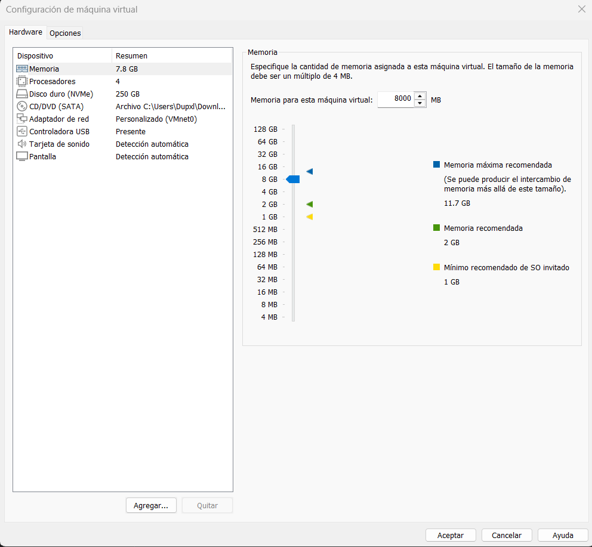

# 01 - Preparación del host

## Objetivo
Dejar listo el entorno donde correrá Proxmox VE: una VM dentro de
VMware Workstation, con virtualización anidada. 

## Equipo host
- CPU: Ryzen 7 serie 5000
- RAM: 16 GB
- Disco libre: 400 GB
- Software: VMware Workstation (versión 26.0.0.25388281)

## Configuración de la VM de Proxmox
| Recurso | Valor |
|---------|-------|
| vCPU    |4      |
| RAM     |8 GB   |
| Disco   | 250 GB|
| Red     | Puente (bridged) |

Virtualización anidada: activé la opción de virtualizar Intel VT-x/AMD-V
en la configuración del procesador de la VM.

## Problemas que tuve
Al abrir la VM, me dio un error debido a que windows no podia correr virtualizacion anidada, por lo que me vi obligado a deshabilitar "core isolation" en el Windows Defender. Con eso, ya pude entrar a la VM sin problemas.

Tuve problemas de red, debido a que mi laptop solamente tiene tarjeta de red wi-fi, el estándar inalámbrico 802.11 bloquea múltiples direcciones MAC en una misma conexión física. Como solución, me vi obligado a cambiar el adaptador de mi VM de Bridged a NAT. Un punto de acceso Wi-Fi asocia cada cliente con una sola MAC, la de mi  tarjeta inalámbrica. Cuando Proxmox y sus VMs usan el puente, salen con MACs distintas, y el router o AP descarta esos paquetes porque no las reconoce, pero en NAT, VMware no pone las MACs de las VMs en el Wi-Fi. Todo el tráfico sale con la MAC de mi laptop, y VMware hace la traducción por dentro. Por eso también las VMs anidadas tendrán internet, aunque estén dos capas adentro.