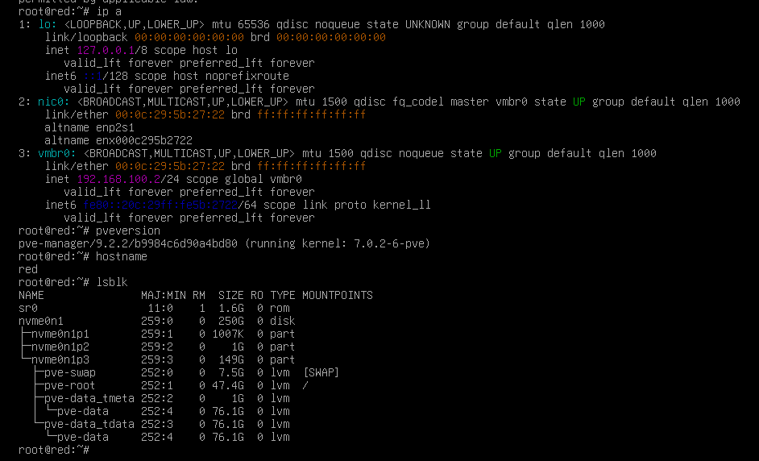
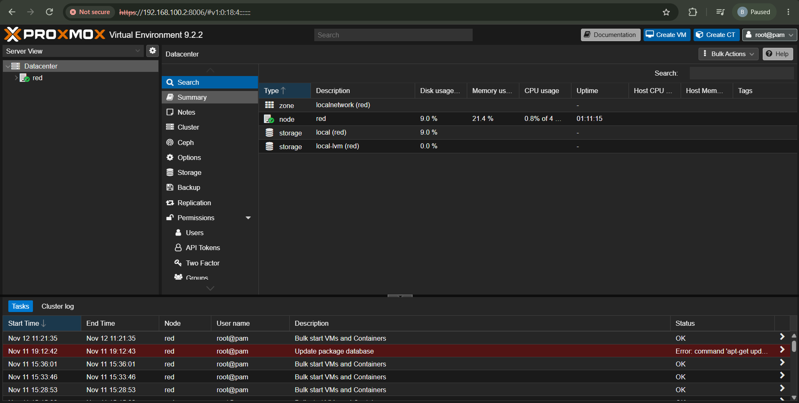

# 02 - Instalación de Proxmox

## Objetivo
Instalación de Proxmox en el host, donde configuro usuario, IP (host/gateway), versión de Proxmox,
primeros comandos en la Bash, URL de acceso desde el navegador, ISO utilizada y red.

## Bash y login
Empecé ingresando mis credenciales `root` para ejecutar los primeros comandos, que muestran
ciertas características de mi hipervisor.

- **ISO utilizada para virtualizar Proxmox:** [Proxmox VE ISO](https://www.proxmox.com/en/downloads/proxmox-virtual-environment/iso)
- **Versión seleccionada:** 9.2-1
- **IP del host:** `192.168.100.2`
- **Gateway:** `192.168.100.10` (adaptador de Windows)

Una vez finalizada la instalación, estamos en la Bash y ejecutamos:

- `pveversion`: confirma la versión exacta.
- `ip a`: muestra la IP del host y el bridge `vmbr0` (switch virtual por defecto).
- `lsblk`: muestra los discos y su tamaño.

En el resultado de `ip a` podemos ver la IP con la que accederemos desde el navegador.
Además, en la parte superior de la Bash ya se indica la URL y el puerto que se utilizan.
En nuestro caso es: `https://192.168.100.2:8006/`

En el panel se observa una tarea en rojo: **Update package database**, con el mensaje
`TASK ERROR: command 'apt-get update' failed: exit code 100`.

Este error ocurre porque Proxmox viene configurado por defecto con los repositorios
**Enterprise**, que requieren una suscripción de pago. Al no tenerla, el servidor de
Proxmox rechaza la conexión (`401 Unauthorized`) y la actualización de paquetes falla.
No indica un problema con la instalación ni con la red.

La solución se documenta en [03 - Interfaz web y configuración inicial](03-interfaz-web-y-config-inicial.md).

