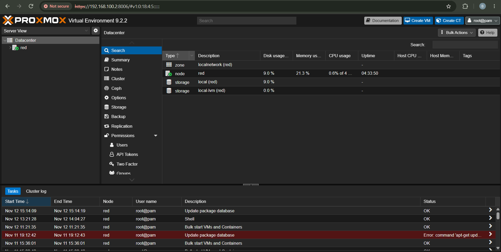
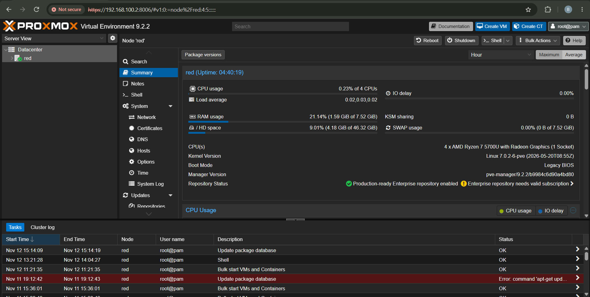
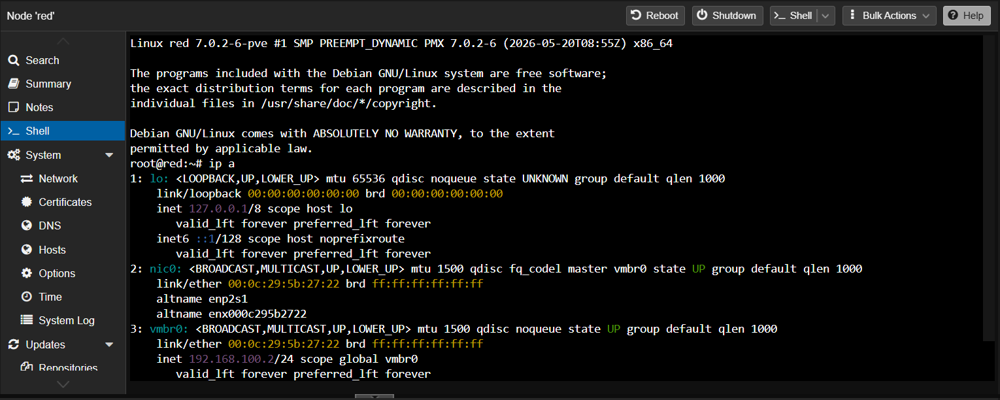
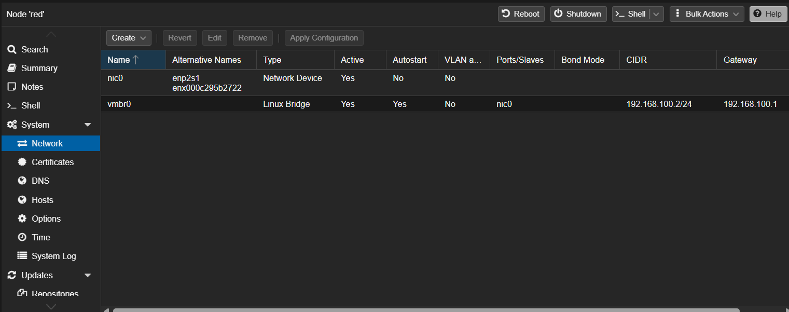
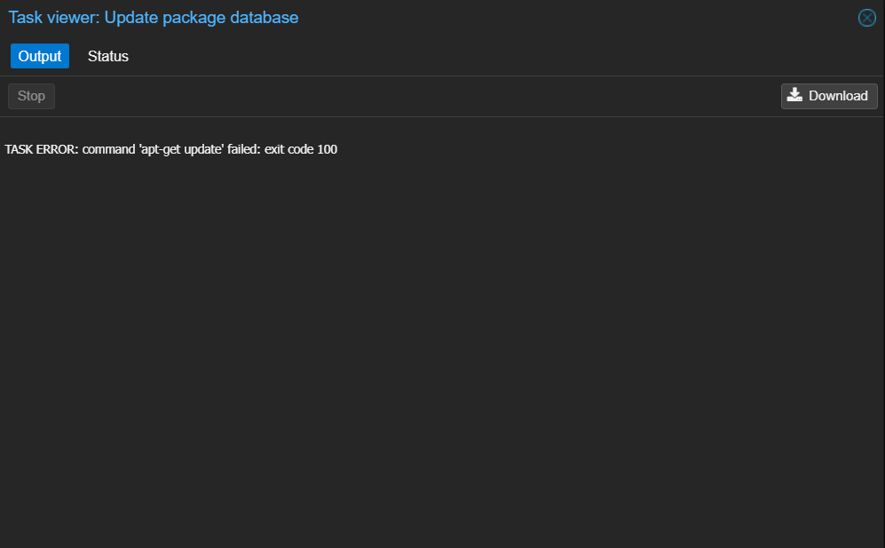
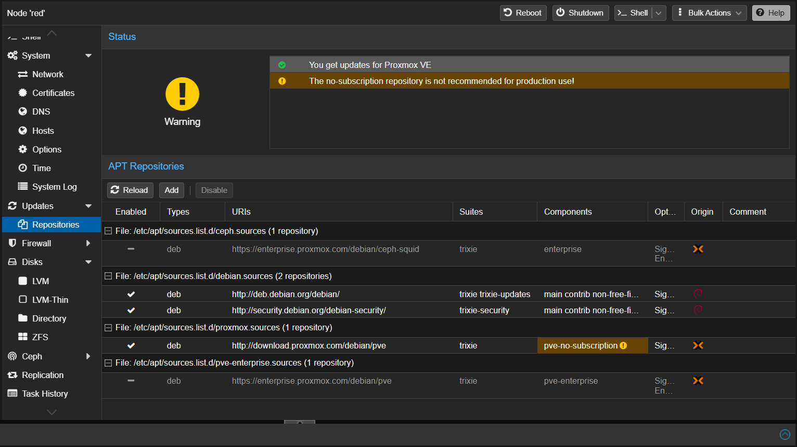
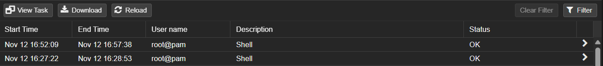

# 03 - Interfaz web y configuración inicial

## Objetivo
Conocer la interfaz web desde la que se administra Proxmox y hacer la
configuración inicial del sistema (repositorios y actualizaciones) para
dejar el entorno listo.

## Recorrido por la interfaz
Una vez dentro de la interfaz web, estos son los apartados principales:

- **Datacenter:** vista global (almacenamiento, permisos, respaldos).

- **Nodo `red` > Summary:** CPU, RAM y versión.

- **Nodo > Shell:** consola del host.

- **Nodo > Network:** el bridge `vmbr0`.

## Problema: `apt-get update` falla (exit code 100)
La tarea "Update package database" terminó con el error
`TASK ERROR: command 'apt-get update' failed: exit code 100`.

**Causa:** Proxmox trae activados los repositorios *enterprise*, que
requieren una suscripción de pago. Sin ella devuelven `401 Unauthorized`
y `apt update` falla.

## Solución
Antes de modificar nada, saqué un snapshot de la VM de Proxmox en VMware,
para poder volver atrás si algo salía mal.

Luego, en el nodo `red`, fui a **Updates > Repositories**:

1. Deshabilité los dos repositorios enterprise (`pve-enterprise` y el de
   Ceph) con **Disable**.
2. Agregué el repositorio **No-Subscription** con **Add** y confirmé.

Proxmox muestra una advertencia porque ese repositorio no está pensado
para producción, lo cual no afecta a un laboratorio.

Después, en la Shell, ejecuté `apt update` y `apt dist-upgrade`. Usé
`dist-upgrade` en lugar de `upgrade` para que también resuelva los
cambios de dependencias.

## Resultado
`apt update` funciona sin errores y el sistema quedó actualizado.