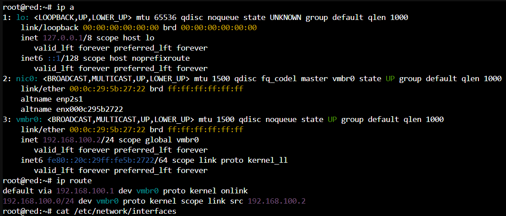
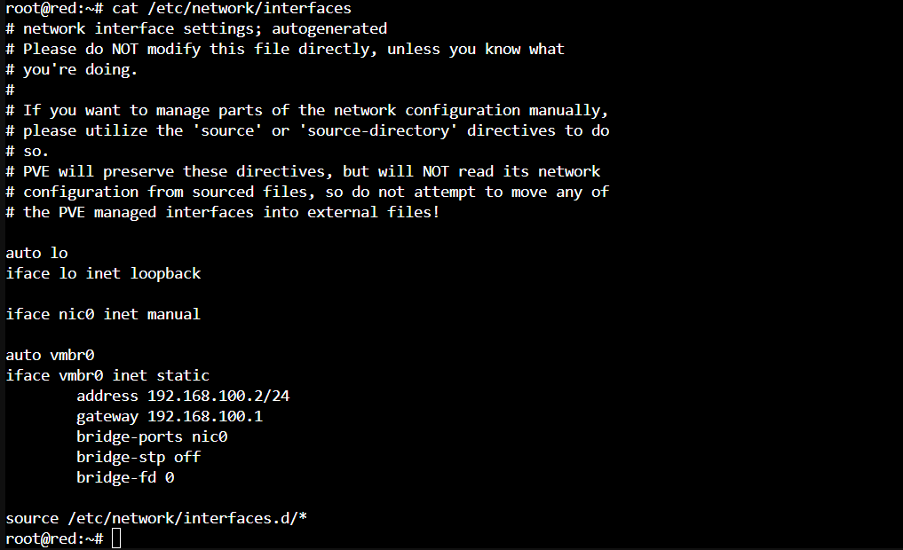
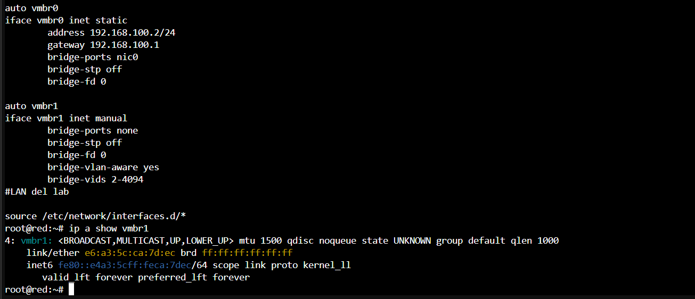

# 04 - Configuración de red y bridges en Proxmox

## Objetivo
En esta parte voy a mostrar las configuraciones de red que haré para mi laboratorio.
Explicaré por qué lo hice de esta manera, los problemas que surgieron y cómo los
solucioné.

## Linux bridge

Antes de tocar las configuraciones, tomé un snapshot en VMware para regresar al estado de
Proxmox antes de las configuraciones de red si es necesario.

Ahora, capturé el estado de mi red en mi nodo con `ip a` para confirmar la IP de mi host, `ip route` para
ver mi gateway y la configuración actual de red, y `cat /etc/network/interfaces` para las interfaces y una
vista más completa y general de mis Linux bridges actuales.

  
  

Después de esto creé mi Linux Bridge en Proxmox. De nombre le dejé `vmbr1`, sin IP ni gateway.

### ¿Por qué?

En mi caso estoy simulando una topología router-on-a-stick y estaré usando switches de capa 2 que
no necesitan direcciones IP. También activé la opción **VLAN aware**, ya que me interesa armar VLANs
para poder separar mi red y tener el enlace troncal (trunk) habilitado sin tener que crear
un bridge o sub-interfaz por cada VLAN. Apliqué los cambios de configuración en **Network** de Proxmox
y confirmé la configuración:

### ¿Surgieron problemas?

Aunque no surgió ningún problema, es importante pensar en "¿y si pasa esto?",
y una de mis dudas era cómo administrar mi red interna aislada en `vmbr1`,
por lo que se me ocurrió usar OPNsense para esta ocasión. Ahora, como por seguridad OPNsense no se
administra por la WAN (`vmbr0`) de forma predeterminada, habría que instalar una VM dentro de mi red interna
(`vmbr1`) que está aislada. Pero antes, eché un vistazo para configurar el almacenamiento en Proxmox antes de
proceder con la instalación de las VMs en [05 - Almacenamiento](05-almacenamiento.md).

